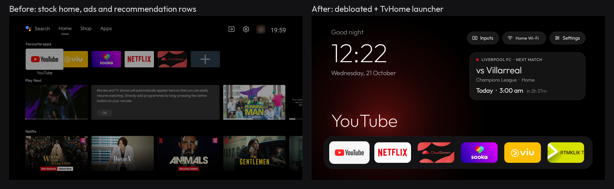
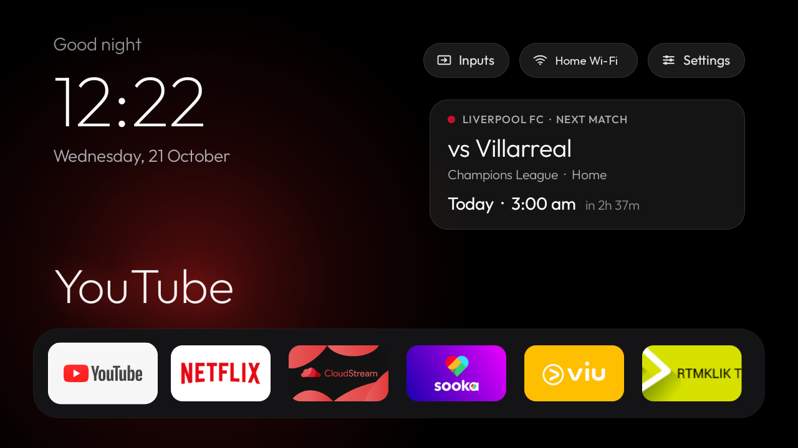
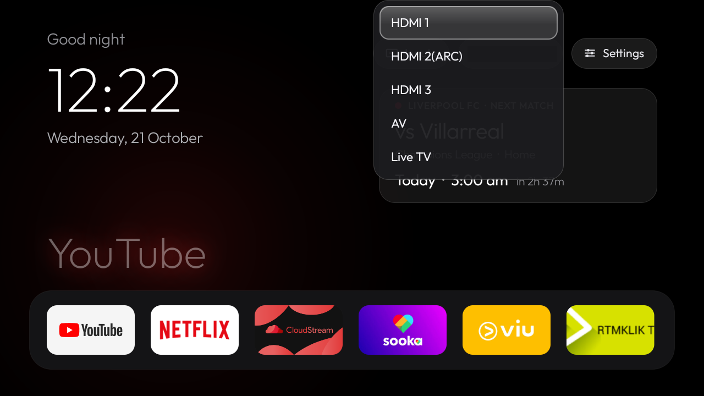

# Android TV Debloat + TvHome

**Let an AI agent clean up your Android TV — safely, step by step — and give it a clean, Apple TV–style home screen.**


> ✅ **Works on Android TV** (TVs, boxes and sticks). Tested end to end on a real Android TV — Xiaomi Mi TV (MiTV-MSSP2, Android TV 9):
> 28 bloat packages disabled, ad-blocking DNS on, TvHome set as the home screen, and HDMI inputs, Live TV, the remote,
> Bluetooth, Chromecast and all streaming apps still working. Other Android TV / Google TV brands use the same system
> and should work the same way ([compatibility](docs/COMPATIBILITY.md)). Samsung (Tizen) and LG (webOS) TVs aren't Android,
> so they can't.



Smart TVs ship with tracking services, ad rows, auto-installers and apps you never use, all competing for about
1 GB of RAM. This repository is a **playbook for AI agents** — made for Claude, and usable by any AI coding agent —
plus the scripts and launcher they need. You paste one sentence; the agent backs up your TV, shows you what it found,
asks before touching anything personal, disables bloat in small verified batches, installs the launcher, and
leaves everything reversible.

> Nothing is uninstalled. Every change is recorded and `scripts/restore.sh` undoes it.

## What you get

- **Less tracking and fewer ads** — manufacturer analytics, recommendation rows, ad services and auto-installers off;
  optional ad-blocking DNS (not YouTube ads).
- **More free memory** — fewer background services, so apps resume instead of reloading.
- **TvHome** — a light launcher (~30–40 MB): big clock, your apps in a dock, the rest in a grid, a glass focus
  highlight, Inputs menu for HDMI/AV/Live TV, Wi-Fi name, optional **next match for your football club**.

| | |
|---|---|
|  |  |

## How to do it

### Option 1 (recommended): let Claude do it — no terminal needed

**Start here.** You don't type any commands or install anything yourself: Claude downloads this kit, installs the tools it
needs and does all the work. You only do the two things it physically can't — turn on developer mode on the TV, and press
OK on the TV when it asks. About 30–60 minutes.

**You need:** a laptop on the **same Wi-Fi as the TV** with the **Claude desktop app** (Mac or Windows), using its
**Code** tab — that's [Claude Code](https://claude.com/claude-code) running on your own computer, which is what lets it
reach your TV. On Linux there's no desktop app, so run Claude Code with `claude`.

1. **On the TV:** Settings → Device Preferences → About → press OK on **Build** 7 times.
   Then Developer options → turn on **USB debugging** (and **Network/ADB debugging** or **Wireless debugging** if listed).
2. **On the laptop:** open the Claude app → **Code**, pick any folder on your computer, and say:

   > Debloat my Android TV using github.com/amirulmzlan/android-tv-debloat. My TV model is ______.

3. **Answer its questions** (which apps you use, what goes in the dock…), say yes when it asks to install a tool, and
   press **OK** on the **"Allow USB debugging?"** prompt on the TV when Claude tells you to.

That's it. Claude backs up the TV first, shows you what it found, disables bloat in small checked batches, installs the
new home screen, and switches debugging off at the end. Changed your mind? Tell Claude to undo it.

<details>
<summary><b>Windows notes</b></summary>

Claude Code on Windows runs the kit's scripts in Git Bash (Git for Windows, which Claude Code uses) and installs adb with
`winget install Google.PlatformTools`. If Windows Firewall asks about `adb.exe`, allow it on private networks.
Not yet tested on Windows — please report how it went.
</details>

### Only if Claude can't reach your TV: run its steps in a terminal

Sometimes Claude runs somewhere that can't see devices on your home Wi-Fi — for example a cloud session, or a sandbox
that blocks local network access. Claude checks this first and tells you. Then, instead of connecting itself, it writes
each step as a small script in the kit's folder; you run it in **Terminal** (Mac/Linux) or **Git Bash** (Windows) and
say "done", and Claude reads the result and screenshots before the next step
([docs/NO-LAN-ACCESS.md](docs/NO-LAN-ACCESS.md)). Same result, just slower — so try Option 1 first.

<details>
<summary><b>Option 2: do it yourself, or with another AI agent</b></summary>

1. `git clone https://github.com/amirulmzlan/android-tv-debloat.git && cd android-tv-debloat` (or *Code → Download ZIP*).
2. Install adb — macOS: `brew install --cask android-platform-tools` · Linux: `sudo apt install adb` ·
   Windows: `winget install Google.PlatformTools`.
3. Turn on developer mode and USB debugging on the TV (step 1 above) and note its IP (Settings → Network).
4. Start any AI coding agent that can run commands in this folder and paste the prompt from **[PROMPT.md](PROMPT.md)**,
   or run the scripts yourself in order (`scripts/01-…` to `scripts/06-…`, then `scripts/close-adb.sh`).

The agent follows **[AGENTS.md](AGENTS.md)**.
</details>

## Just the launcher (no AI)

Download **[TvHome.apk](https://github.com/amirulmzlan/android-tv-debloat/releases/latest/download/TvHome.apk)** from the [latest release](https://github.com/amirulmzlan/android-tv-debloat/releases/latest) (also in [`dist/`](dist/); SHA-256 in `dist/TvHome.apk.sha256`), then:
```
adb connect <tv-ip>:5555
adb install -r TvHome.apk
adb shell cmd package set-home-activity net.amirul.tvhome/.HomeActivity
```
Most Android TVs also need the stock launcher disabled before Home goes to TvHome (it outranks other launchers):
`adb shell pm disable-user --user 0 com.google.android.tvlauncher` — see [docs/LAUNCHER.md](docs/LAUNCHER.md)
for settings (dock apps, columns, football team, wallpaper) and the Google TV caveats in [AGENTS.md](AGENTS.md).

## Undo

```
./scripts/restore.sh            # re-enable everything, DNS back to automatic, stock home back
./scripts/restore.sh <package>  # just one app
adb uninstall net.amirul.tvhome # remove the launcher
```
Without a computer: Settings → Apps → See all apps → Show system apps → pick the app → **Enable**.

## Is it safe?

- The agent **backs up first**, never uninstalls system apps, and keeps everything the TV needs (TV inputs/HDMI,
  remote and Bluetooth pairing, keyboard, Play Store/Services). Unclear packages are checked or left alone.
- Changes go in **small batches with a screenshot after each**, so a problem is caught immediately and is easy to undo.
- At the end it **switches ADB off** — leaving it on lets devices on your network control the TV.
- Some TVs reject custom launchers (see [examples/README.md](examples/README.md)); then you still get the debloat.
- You're changing your own device's settings at your own risk; this isn't affiliated with Google, Xiaomi or any TV maker.

## Repository

| Path | What |
|---|---|
| [PROMPT.md](PROMPT.md) | The prompt to paste into your AI agent |
| [AGENTS.md](AGENTS.md) | The playbook the agent follows (rules, phases, gotchas) |
| `scripts/` | Backup, debloat-by-batch, DNS, launcher install/activate/config, restore, close ADB |
| `launcher/` | TvHome source (Java, Android 9+) |
| [docs/](docs/) | Compatibility, package reference, troubleshooting, launcher settings, remote TVs via Tailscale, sandboxed agents |
| [examples/](examples/) | Tested devices and what each needed — add yours! |

## Which TVs?

**Android TV and Google TV only** — TVs (Xiaomi, TCL, Sony, Philips, Hisense Android/Google TV models…) and
**boxes and sticks** (Xiaomi Mi Box S, Mi TV Stick, Nvidia Shield, Chromecast with Google TV…). **Samsung (Tizen), LG (webOS), Roku, VIDAA and Apple TV can't** — they aren't
Android. Full list, partial cases (older Android, China-market firmware, Fire TV) and alternatives:
**[docs/COMPATIBILITY.md](docs/COMPATIBILITY.md)**.

| Tested | Android | Result |
|---|---|---|
| Xiaomi Mi TV MiTV-MSSP2 (global) | 9 | Debloat (28 packages) + DNS + TvHome ✅ — [notes](examples/xiaomi-mitv-mssp2.md) |

Tried it on another TV? Open an issue or pull request with an `examples/` file — that's how the playbook gets better.

## License

Code: MIT ([LICENSE](LICENSE)). Font: Outfit, SIL Open Font License ([launcher/app/src/main/assets/fonts/OFL.txt](launcher/app/src/main/assets/fonts/OFL.txt)).
